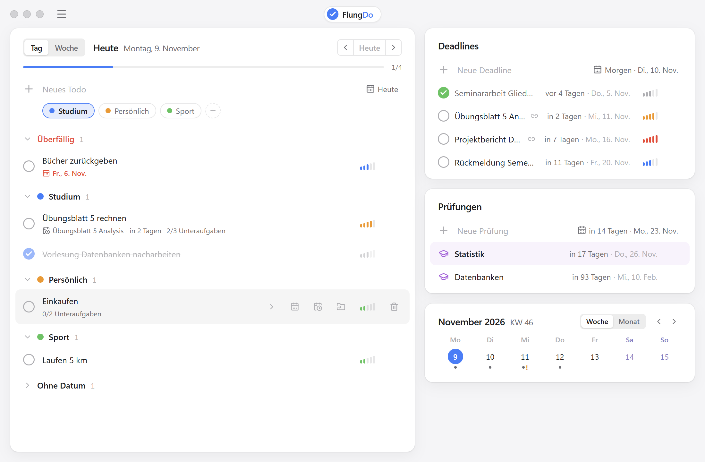
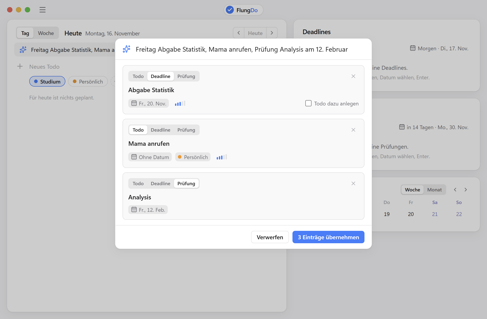

# FlungDo

[](https://github.com/flungermanuel/ToDo/actions/workflows/ci.yml)

Eine ruhige, aufgeräumte Desktop-App für Windows, in der man Todos, Deadlines, Prüfungen
und seine Woche an einem Ort plant, mit einer Optik, die sich an macOS orientiert.
Läuft komplett lokal: kein Konto, kein Server, keine Cloud.



Ein persönliches Lernprojekt mit Fokus auf saubere Architektur, nachvollziehbaren Code und
Datensicherheit.

## Funktionen

- **Todos** mit Priorität (5 Stufen), Unteraufgaben, Datum und farbigen **Kategorien**
- **Deadlines** nach Fälligkeit sortiert, Überfälliges markiert, optional 1:1 mit einem Todo
  verknüpft (Todo abhaken → Deadline erledigt)
- **Prüfungen** mit Countdown
- **Tages- und Wochenansicht** (Mo–So, Kalenderwoche nach ISO 8601), „Überfällig“ und
  „Ohne Datum“, Fortschrittsbalken für den Tag
- **Kalender-Widget** (Woche/Monat): Klick auf einen Tag öffnet seine Tagesansicht
- **KI-Eingabe**: Freitext tippen, bestätigen, fertig (lokal über Ollama, siehe unten)
- Löschen lässt sich ein paar Sekunden lang **rückgängig** machen
- **Export und Import** der Daten als JSON-Datei, Import mit Nachfrage und automatischer Sicherung
- Hell-/Dunkelmodus nach Systemeinstellung, eigene schlanke Titelleiste

## Technik

| Bereich | Wahl |
|---|---|
| Desktop | Electron 45, gebaut mit electron-vite, Installer mit electron-builder |
| Oberfläche | React 19, TypeScript, Tailwind CSS, Radix UI, Lucide Icons, Motion |
| Speicherung | SQLite über das eingebaute `node:sqlite`, reines SQL ohne ORM |
| KI-Eingabe | Ollama, lokal auf dem eigenen Rechner (Standardmodell `gemma3:4b`) |
| Qualität | Vitest (Unit-, Vertrags- und Migrationstests), ESLint, Prettier, GitHub Actions |

Drei strikt getrennte Schichten: **UI** (`src/renderer`), **Logik** aus reinen Funktionen
(`src/core`) und **Speicherung** hinter einem kleinen Interface (`src/main/storage`). Die UI
spricht nur über IPC mit dem Main-Prozess und kennt weder Dateien noch SQL.

Mehr dazu:
- [Architektur](docs/architecture.md): Schichten, Datenfluss, Datenmodell, Migrationen
- [Entscheidungen](docs/decisions.md): Warum Electron, SQLite, `node:sqlite`, kein ORM …
- [Performance](docs/performance.md): Messungen mit 1.000 bis 10.000 Todos, vorher/nachher
- [Evaluation](docs/evaluation.md): Welches Modell versteht deutsche Eingaben am besten
- [Verpacken](docs/packaging.md): Installer, Tests, Stolpersteine

## KI-Eingabe

Ein Eingabefeld im Todo-Widget (oder `Strg+K` von überall) nimmt Freitext auf Deutsch:

> Freitag Abgabe Statistik, Mama anrufen, Prüfung Analysis am 12. Februar

Daraus entstehen drei Vorschau-Karten: eine **Deadline** (Abgabe Statistik, nächster Freitag),
ein **Todo** (Mama anrufen) und eine **Prüfung** (Analysis, 12. Februar). Titel, Datum,
Kategorie und Priorität lassen sich ändern, jede Karte kann entfernt werden. Erst „Übernehmen“
legt etwas an, danach lässt sich alles mit einem Klick rückgängig machen. Bei einer Deadline
kann ein verknüpftes Todo gleich mit angelegt werden.



- **Lokal und privat.** Die Analyse läuft über [Ollama](https://ollama.com) auf diesem Rechner.
  Deine Eingaben verlassen ihn nicht und werden weder gespeichert noch protokolliert.
- **Der Code rechnet das Datum**, nicht das Modell: Das Modell schreibt nur „übernächsten
  Freitag“ ab, `resolveDate` macht daraus den Kalendertag. Versteht der Code einen Ausdruck
  nicht, steht auf der Karte „Datum fehlt“.
- **Nichts geht verloren.** Ist Ollama nicht erreichbar, läuft in einen Timeout oder liefert
  Unsinn, bleibt dein Text im Feld und es öffnet sich eine Karte mit dem Text als Titel.

### Einrichtung

1. [Ollama](https://ollama.com/download) installieren und starten (kein Konto nötig, es
   genügt die lokale Installation).
2. Das Standardmodell laden (rund 3,4 GB): `ollama pull gemma3:4b`
3. In FlungDo unter Seitenleiste → KI-Eingabe prüfen, ob „Ollama erreichbar“ steht. Dort lässt
   sich auch ein anderes installiertes Modell wählen.

Ohne Ollama funktioniert alles andere in FlungDo unverändert.

### Modellempfehlung

Gemessen auf einem Laptop mit 16 GB RAM, nur CPU (Details: [Evaluation](docs/evaluation.md)):

| Modell | komplett richtig (40 Sätze) | Dauer pro Eingabe |
|---|---|---|
| `gemma3:4b` (Standard) | 37 | rund 14 s |
| `llama3.2:3b` | 31 | rund 5 s |

Das erste Laden eines Modells dauert etwa 16 s, danach bleibt es 30 Minuten im Speicher.
`llama3.2:3b` ist schneller, legt aber öfter doppelte oder falsche Karten an.

## Datensicherheit

- Jedes Speichern ist eine Transaktion: ganz oder gar nicht
- Automatische Sicherungen vor jeder Migration, jedem Import und der Übernahme aus 1.x
- Beim Update von 1.x werden die Daten aus der JSON-Datei übernommen, gegengeprüft und erst
  dann umgestellt; die alte Datei bleibt als `todo-data.migrated.json` erhalten
- Daten liegen in `%APPDATA%\FlungDo` und bleiben beim Deinstallieren erhalten

## Installation

Installer von der [Releases-Seite](https://github.com/flungermanuel/ToDo/releases) herunterladen
und ausführen. FlungDo wird für den aktuellen Benutzer installiert (keine Admin-Rechte nötig).

## Entwicklung

Voraussetzung: Node.js 24.

```bash
npm install
npm run dev         # App mit Hot Reload starten
npm test            # Unit-Tests (Vitest)
npm run typecheck   # TypeScript prüfen
npm run lint        # ESLint
npm run dist        # Windows-Installer nach dist/
```

Weitere Befehle:

```bash
npm run bench                          # Speicherung messen (JSON vs. SQLite)
node scripts/seed.mjs perf-data        # Testdaten mit 1.000/5.000/10.000 Todos
node scripts/measure.mjs perf-data     # echte App messen (vorher npm run build)
npm run eval -- --provider ollama --model gemma3:4b   # KI-Eingabe messen (braucht Ollama)
```

Mit `FLUNGDO_DATA_DIR=<Ordner>` nutzt die App einen anderen Daten-Ordner, praktisch zum
Ausprobieren, ohne die eigenen Daten anzufassen. `FLUNGDO_AI=fake` ersetzt Ollama durch feste
Antworten (Entwicklung ohne Modell), `FLUNGDO_AI_MODEL=<name>` wählt ein anderes Modell.
Die CI und `npm test` brauchen weder Ollama noch Netzwerk.

## Bekannte Einschränkungen

- **Nur Windows.** Der Code ist plattformunabhängig, gebaut und getestet wird aber nur für Windows.
- **Unsignierter Installer.** Windows SmartScreen warnt beim ersten Start („Unbekannter
  Herausgeber“), weiter über „Weitere Informationen → Trotzdem ausführen“.
- **Kein Downgrade.** Nach dem Update auf 2.0 liegen die Daten in einer Datenbank; eine
  wieder installierte 1.x findet sie nicht.
- **Kein Sync.** Daten liegen nur auf diesem Rechner. Zum Umziehen: Export und Import.
- **KI-Eingabe braucht Ollama** (separat installiert) und ist auf der CPU langsam: rund 14 s pro
  Eingabe mit dem Standardmodell. Sie versteht nur Deutsch und noch keine Uhrzeiten.
- `node:sqlite` gilt in Node 24 noch als experimentell (siehe [Entscheidungen](docs/decisions.md)).
