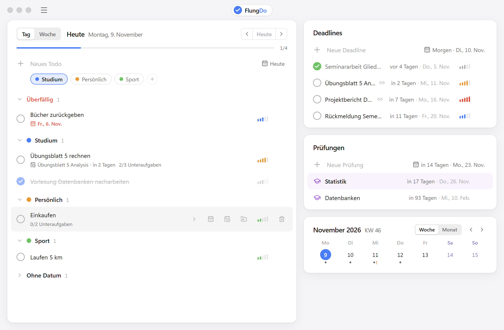

# FlungDo

[](https://github.com/flungermanuel/ToDo/actions/workflows/ci.yml)

Eine ruhige, aufgeräumte Desktop-App für Windows, in der man Todos, Deadlines, Prüfungen
und seine Woche an einem Ort plant, mit einer Optik, die sich an macOS orientiert.
Läuft komplett lokal: kein Konto, kein Server, keine Cloud.



Ein persönliches Lernprojekt mit Fokus auf saubere Architektur, nachvollziehbaren Code und
Datensicherheit.

## Funktionen

- **Todos** mit Priorität (5 Stufen), Unteraufgaben, Datum und farbigen **Kategorien**
- **Deadlines** nach Fälligkeit sortiert, Überfälliges markiert, optional 1:1 mit einem Todo
  verknüpft (Todo abhaken → Deadline erledigt)
- **Prüfungen** mit Countdown
- **Tages- und Wochenansicht** (Mo–So, Kalenderwoche nach ISO 8601), „Überfällig“ und
  „Ohne Datum“, Fortschrittsbalken für den Tag
- **Kalender-Widget** (Woche/Monat): Klick auf einen Tag öffnet seine Tagesansicht
- Löschen lässt sich ein paar Sekunden lang **rückgängig** machen
- **Export und Import** der Daten als JSON-Datei, Import mit Nachfrage und automatischer Sicherung
- Hell-/Dunkelmodus nach Systemeinstellung, eigene schlanke Titelleiste

## Technik

| Bereich | Wahl |
|---|---|
| Desktop | Electron 45, gebaut mit electron-vite, Installer mit electron-builder |
| Oberfläche | React 19, TypeScript, Tailwind CSS, Radix UI, Lucide Icons, Motion |
| Speicherung | SQLite über das eingebaute `node:sqlite`, reines SQL ohne ORM |
| Qualität | Vitest (Unit-, Vertrags- und Migrationstests), ESLint, Prettier, GitHub Actions |

Drei strikt getrennte Schichten: **UI** (`src/renderer`), **Logik** aus reinen Funktionen
(`src/core`) und **Speicherung** hinter einem kleinen Interface (`src/main/storage`). Die UI
spricht nur über IPC mit dem Main-Prozess und kennt weder Dateien noch SQL.

Mehr dazu:
- [Architektur](docs/architecture.md): Schichten, Datenfluss, Datenmodell, Migrationen
- [Entscheidungen](docs/decisions.md): Warum Electron, SQLite, `node:sqlite`, kein ORM …
- [Performance](docs/performance.md): Messungen mit 1.000 bis 10.000 Todos, vorher/nachher
- [Verpacken](docs/packaging.md): Installer, Tests, Stolpersteine

## Datensicherheit

- Jedes Speichern ist eine Transaktion: ganz oder gar nicht
- Automatische Sicherungen vor jeder Migration, jedem Import und der Übernahme aus 1.x
- Beim Update von 1.x werden die Daten aus der JSON-Datei übernommen, gegengeprüft und erst
  dann umgestellt; die alte Datei bleibt als `todo-data.migrated.json` erhalten
- Daten liegen in `%APPDATA%\FlungDo` und bleiben beim Deinstallieren erhalten

## Installation

Installer von der [Releases-Seite](https://github.com/flungermanuel/ToDo/releases) herunterladen
und ausführen. FlungDo wird für den aktuellen Benutzer installiert (keine Admin-Rechte nötig).

## Entwicklung

Voraussetzung: Node.js 24.

```bash
npm install
npm run dev         # App mit Hot Reload starten
npm test            # Unit-Tests (Vitest)
npm run typecheck   # TypeScript prüfen
npm run lint        # ESLint
npm run dist        # Windows-Installer nach dist/
```

Weitere Befehle:

```bash
npm run bench                          # Speicherung messen (JSON vs. SQLite)
node scripts/seed.mjs perf-data        # Testdaten mit 1.000/5.000/10.000 Todos
node scripts/measure.mjs perf-data     # echte App messen (vorher npm run build)
```

Mit `FLUNGDO_DATA_DIR=<Ordner>` nutzt die App einen anderen Daten-Ordner, praktisch zum
Ausprobieren, ohne die eigenen Daten anzufassen.

## Bekannte Einschränkungen

- **Nur Windows.** Der Code ist plattformunabhängig, gebaut und getestet wird aber nur für Windows.
- **Unsignierter Installer.** Windows SmartScreen warnt beim ersten Start („Unbekannter
  Herausgeber“), weiter über „Weitere Informationen → Trotzdem ausführen“.
- **Kein Downgrade.** Nach dem Update auf 2.0 liegen die Daten in einer Datenbank; eine
  wieder installierte 1.x findet sie nicht.
- **Kein Sync.** Daten liegen nur auf diesem Rechner. Zum Umziehen: Export und Import.
- `node:sqlite` gilt in Node 24 noch als experimentell (siehe [Entscheidungen](docs/decisions.md)).
